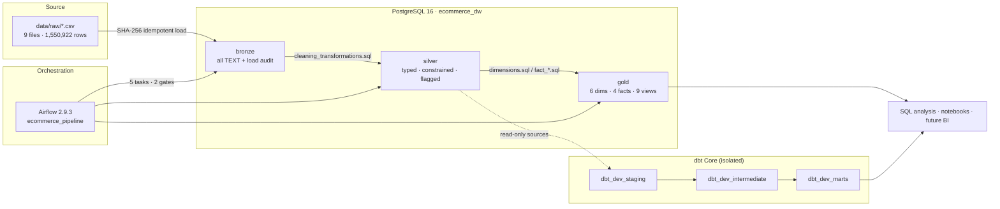

# Enterprise E-Commerce Data Platform


A production-shaped **medallion data warehouse** for the Olist Brazilian
e-commerce dataset. Nine raw CSVs land in a text-only **Bronze** layer with
SHA-256 load auditing, become a typed and constrained **Silver** layer, and are
published as a **Gold** star schema with six dimensions, four facts, and nine
analytical views. **Apache Airflow** orchestrates a five-task, two-gate DAG;
**dbt Core** maintains an isolated 33-model development branch with 162 tests.
The project is built to be reproducible, auditable, and honest about its
trade-offs.

> **Status:** warehouse build, quality gates, and dbt layer are implemented and
> validated. The Airflow Compose stack currently lives outside this repository;
> see [Quickstart](#quickstart) and [docs/runbook.md](docs/runbook.md).

---

## Architecture



Two transformation paths are intentional:

1. **Production path** — SQL in `sql/` builds Bronze → Silver → Gold.
2. **Development path** — dbt reads Silver and writes only to `dbt_dev_*`.

---

## Tech stack

| Concern | Choice | Why |
|---|---|---|
| Language | Python 3.11 | pandas, SQLAlchemy, dbt |
| Warehouse | PostgreSQL 16 | Constraints, window functions, `percentile_cont`, free |
| Processing | pandas 2.x, NumPy, PyArrow | Text-safe CSV handling |
| DB access | SQLAlchemy 2 + psycopg2 | Transactional SQL execution |
| Transformations | SQL-first | Auditable, portable, enforced by the database |
| Orchestration | Apache Airflow 2.9.3 (LocalExecutor) | Retries, gates, UI, task logs |
| Modelling | dbt Core 1.9.4 / dbt-postgres 1.9.0 | Staging/intermediate/marts, tests, lineage |
| Containers | Docker Compose | Reproducible local Postgres + app |
| Testing | pytest, dbt tests | Unit, live integration, data contracts |
| Lint/format | ruff, black | Configured in `pyproject.toml` |

---

## Quickstart

### Prerequisites

- Python 3.11+
- Docker + Docker Compose
- PostgreSQL client (`psql`)
- The nine raw CSVs in `data/raw/`

### 1. Configure environment

```bash
cp .env.example .env
# edit .env with your PostgreSQL values; never commit it
```

### 2. Start PostgreSQL (and the app image)

```bash
cd infrastructure/docker
docker compose up -d postgres
docker compose ps
```

The `postgres` service mounts `sql/database/` into the init directory, so an
empty volume gets the database and schemas automatically. For an existing host
PostgreSQL, apply the SQL manually:

```bash
psql -U postgres -f sql/database/01_create_database.sql
psql -U ecommerce_etl -d ecommerce_dw -f sql/database/02_create_schemas.sql
psql -U ecommerce_etl -d ecommerce_dw -f sql/bronze/create_bronze_tables.sql
psql -U ecommerce_etl -d ecommerce_dw -f sql/silver/create_silver_tables.sql
```

### 3. Start Airflow

The current Airflow stack is a separate Compose project (it is **not** yet
vendored into this repo). Start it, open <http://localhost:8080>, and confirm
the `ecommerce_pipeline` DAG is present:

```bash
# current workstation layout
cd ~/projects/airflow
docker compose up -d
docker compose ps
```

The Airflow containers bind-mount this repository at `/opt/airflow/project` and
symlink `orchestration/airflow/dags/ecommerce_pipeline_dag.py` into
`/opt/airflow/dags`.

### 4. Add the warehouse connection

Create an Airflow connection named `ecommerce_postgres` (or set
`ECOMMERCE_AIRFLOW_CONN_ID`) pointing at the warehouse:

| Warehouse location | Host to use |
|---|---|
| Host PostgreSQL (current) | `host.docker.internal` |
| Postgres in the same Compose network | `postgres` |
| Remote managed Postgres | hostname/FQDN |

```bash
docker exec -it airflow_airflow-scheduler_1 airflow connections add ecommerce_postgres \
  --conn-type postgres \
  --conn-host host.docker.internal \
  --conn-schema ecommerce_dw \
  --conn-login ecommerce_etl \
  --conn-password 'REPLACE_WITH_SECRET' \
  --conn-port 5432

docker exec -it airflow_airflow-scheduler_1 airflow connections test ecommerce_postgres
```

> PostgreSQL must accept connections from the Docker bridge. If it listens only
> on `127.0.0.1`, `bronze_load` fails with `Connection refused`. See
> [docs/runbook.md](docs/runbook.md) §7.

### 5. Trigger the DAG

```bash
docker exec -it airflow_airflow-scheduler_1 airflow dags trigger ecommerce_pipeline
docker exec -it airflow_airflow-scheduler_1 airflow dags list-runs -d ecommerce_pipeline
```

Or use the UI: **DAGs → ecommerce_pipeline → Trigger DAG**.

Expected task order:

```text
bronze_load → bronze_quality_gate → silver_rebuild →
silver_quality_gate → gold_build
```

### 6. Run without Airflow (debugging)

```bash
python -m venv .venv && source .venv/bin/activate
pip install -r requirements.txt
python scripts/run_pipeline.py --stage load
```

---

## Repository layout

```text
enterprise-ecommerce-data-platform/
├── data/                       # raw, processed, warehouse, sample
├── dbt_project/ecommerce_dbt/  # 33 dbt models, 162 tests, macros
├── docs/                       # architecture, runbook, dictionary, ADRs
├── infrastructure/
│   ├── docker/                 # Dockerfile + Postgres/app Compose
│   ├── monitoring/             # Grafana/Prometheus placeholders
│   └── postgres/
├── notebooks/                  # 4 exploration notebooks (shells)
├── orchestration/airflow/      # DAG, config, plugins
├── scripts/                    # inventory, pipeline runner, dbt env
├── sql/                        # bronze, silver, gold, analysis, security
├── src/ecommerce_pipeline/     # ingestion, profiling, validation, loading
├── tests/                      # unit + live integration tests
├── pyproject.toml
├── requirements.txt
└── requirements-dbt.txt
```

---

## Pipeline stages

| Stage | Implemented by | Output | Idempotency |
|---|---|---|---|
| Raw | `data/raw/*.csv` | 9 source files | Immutable snapshot |
| Bronze | `load_bronze()` | 9 text tables + 2 audit tables | SHA-256 skip; retry clears partial rows |
| Bronze gate | `bronze_quality_gate` | pass/fail | Exact row counts, 0 rejects |
| Silver | `sql/silver/cleaning_transformations.sql` | 9 typed tables + rejects | Full rebuild (`TRUNCATE ... CASCADE`) |
| Silver gate | `silver_quality_gate` | pass/fail | 11 key + 9 not-null + 7 relationship checks |
| Gold | `sql/gold/*.sql` | 6 dims, 4 facts, 9 views | Full rebuild (`DROP ... CASCADE`) |
| dbt | `dbt_project/ecommerce_dbt` | 33 models in `dbt_dev_*` | Table/view rebuild, deterministic keys |

### Bronze

- Every source column is `TEXT`; leading zeros and malformed values survive.
- Audit columns: `_load_id`, `_source_file`, `_source_row_number`, `_loaded_at`.
- `UNIQUE(_load_id, _source_row_number)` prevents duplicates within a batch.
- Malformed rows go to `bronze.rejected_rows`, never silently dropped.
- Audited snapshot: **1,550,922 rows / 9 batches / 0 rejects**.

### Silver

- Types, PK/FK constraints, and checks are enforced by PostgreSQL.
- Suspicious records are **retained and flagged**, not deleted.
- Malformed records go to `silver.rejected_rows`.
- Row counts: customers 99,441 · sellers 3,095 · products 32,951 ·
  geolocation 738,300 · orders 99,441 · items 112,650 · payments 103,886 ·
  reviews 99,224 · categories 74.

### Gold

- `fact_orders` (1/order) joins independently pre-aggregated items, payments,
  and reviews to avoid fan-out.
- `fact_order_items` (1/item), `fact_payments` (1/payment sequence),
  `fact_reviews` (1/review record).
- `dim_geolocation` collapses 1,000,163 raw points to one row per zip using
  median coordinates that prefer non-outliers.

---

## Data dictionary

| Layer | Objects | Reference |
|---|---|---|
| Bronze | 9 data tables + `load_batches` + `rejected_rows` | [docs/data_dictionary.md](docs/data_dictionary.md#1-bronze-layer) |
| Silver | 9 typed tables + `rejected_rows` | [docs/data_dictionary.md](docs/data_dictionary.md#2-silver-layer) |
| Gold | 6 dimensions, 4 facts, 9 views | [docs/data_dictionary.md](docs/data_dictionary.md#3-gold-layer) |
| dbt | 9 staging, 5 intermediate, 19 dim/fact/mart tables | [docs/data_dictionary.md](docs/data_dictionary.md#4-dbt-development-models-dbt_dev_) |

Dataset:

| File | Rows | Grain |
|---|---:|---|
| `olist_customers_dataset.csv` | 99,441 | one row per `customer_id` |
| `olist_geolocation_dataset.csv` | 1,000,163 | one observed point per zip |
| `olist_order_items_dataset.csv` | 112,650 | one row per order item |
| `olist_order_payments_dataset.csv` | 103,886 | one payment sequence |
| `olist_order_reviews_dataset.csv` | 99,224 | one review record |
| `olist_orders_dataset.csv` | 99,441 | one order |
| `olist_products_dataset.csv` | 32,951 | one product |
| `olist_sellers_dataset.csv` | 3,095 | one seller |
| `product_category_name_translation.csv` | 71 | one category |

---

## Quality gates

| Gate | Checks | On failure |
|---|---|---|
| Bronze | Latest successful batch per file equals `EXPECTED_ROWS`; zero rejected rows | DAG fails before Silver |
| Silver | 11 key-uniqueness checks, 9 required-value checks, 7 relationship checks | DAG fails before Gold |
| Gold | **Not yet gated in the DAG** | Known gap |
| dbt | 162 tests (39 source + 123 model); 195-check full build | Separate command, not orchestrated |

Known retained conditions (not silently dropped): 775 orders without items,
1 payment-less order, 768 unreviewed orders, 1,076 payment mismatches, 1,382
delivery anomalies, 610 uncategorised products, 74 reviews before purchase,
33 geolocation outliers.

Profiling detail: [docs/data_quality/data_quality_report.md](docs/data_quality/data_quality_report.md).

---

## dbt development layer

dbt reads the nine Silver tables as **read-only sources** and writes only to
isolated schemas:

```text
silver.* → dbt_dev_staging → dbt_dev_intermediate → dbt_dev_marts
```

- **33 models**: 9 staging, 5 intermediate, 6 dimensions, 4 facts, 9 marts.
- **162 tests** and a **195-check full build** (0 errors).
- Deterministic MD5 keys over natural identifiers, stable across rebuilds.
- A `generate_schema_name` macro fails closed on any target other than
  `dbt_dev` or any resource type that is not a model/test.
- A least-privilege `dbt_dev_user` has no Bronze/Gold access and no
  superuser/createdb/createrole privileges.

```bash
export DBT_PROJECT_DIR="$PWD/dbt_project/ecommerce_dbt"
export DBT_PROFILES_DIR="$PWD/dbt_project/ecommerce_dbt"
export DBT_POSTGRES_HOST=localhost
export DBT_POSTGRES_PORT=5432
export DBT_POSTGRES_DB=ecommerce_dw
export DBT_POSTGRES_USER=dbt_dev_user
read -rsp 'dbt password: ' DBT_POSTGRES_PASSWORD; printf '\n'; export DBT_POSTGRES_PASSWORD

.venv-dbt/bin/dbt debug
.venv-dbt/bin/dbt build
.venv-dbt/bin/dbt test
```

dbt corrects several Gold metrics (carrier-handoff shipping flag, order-weighted
seller/category metrics, delivery population). See
[docs/dbt_architecture.md](docs/dbt_architecture.md) and
[docs/progress/dbt_implementation_report.md](docs/progress/dbt_implementation_report.md).

---

## Analytical outputs

Gold ships nine views: daily sales, delivery performance, customer RFM, category
performance, seller performance, payment mix, review summary, payment
reconciliation, and data-quality flags. Runnable business queries live in
`sql/analysis/` (`sales`, `customer`, `product`, `delivery`).

---

## What is intentionally out of scope

- **Live ingestion / streaming / CDC** — the source is a static snapshot.
- **Incremental Silver/Gold** — full rebuilds are deliberate for this size.
- **A BI tool** — dashboard folders are placeholders; SQL is the serving surface.
- **Cloud deployment** — the stack is local Docker + host PostgreSQL.
- **ML models** — no training or serving code.
- **A vendored Airflow Compose** — currently external to the repo.
- **CI/CD** — planned, not implemented.

---

## Known limitations

- The Airflow connection must reach the warehouse; a host PostgreSQL bound to
  `127.0.0.1` is not reachable from the Docker bridge.
- Silver/Gold rebuilds use `CASCADE` and can disrupt external dependents.
- Gold and dbt disagree on some business metrics by design; Gold is the legacy
  comparison layer, not the canonical corrected layer.
- A Bronze retry does not clear `bronze.rejected_rows` for the batch, so reject
  counts can duplicate across retries.
- Notebooks are empty shells and add no analytical value yet.

---

## Next steps

1. Expose or containerise PostgreSQL so Airflow can reach it on the Docker
   network; update `ecommerce_postgres`.
2. Vendor the Airflow Compose project into `infrastructure/airflow/`.
3. Add CI: ruff, unit tests, and `dbt build` against an ephemeral PostgreSQL.
4. Add a post-Gold quality gate and orchestrate dbt tests from the DAG.
5. Enable failure alerting and an SLA, then add a freshness/quality dashboard.
6. Reconcile Gold vs dbt metric semantics or migrate the affected Gold views.

---

## Documentation

| Document | Purpose |
|---|---|
| [docs/architecture.md](docs/architecture.md) | Data flow, components, scheduling, rebuild trade-offs |
| [docs/runbook.md](docs/runbook.md) | Bring-up, trigger, logs, troubleshooting, teardown |
| [docs/data_dictionary.md](docs/data_dictionary.md) | Every Bronze/Silver/Gold/dbt object |
| [docs/portfolio.md](docs/portfolio.md) | Resume bullets, scholarship summary, highlights |
| [docs/decisions.md](docs/decisions.md) | ADRs for the key design choices |
| [docs/architecture/system_architecture.md](docs/architecture/system_architecture.md) | Legacy component view |
| [docs/architecture/data_flow.md](docs/architecture/data_flow.md) | Legacy data-flow notes |
| [docs/architecture/erd.md](docs/architecture/erd.md) | Entity relationships and grains |
| [docs/data_quality/data_quality_report.md](docs/data_quality/data_quality_report.md) | Profiling findings |
| [docs/pipeline/pipeline_documentation.md](docs/pipeline/pipeline_documentation.md) | Stage commands and validation |
| [docs/dbt_architecture.md](docs/dbt_architecture.md) | dbt schemas, lineage, corrected metrics |
| [docs/dbt_models.md](docs/dbt_models.md) | Model purposes, rows, tests |
| [docs/dbt_security_setup.md](docs/dbt_security_setup.md) | Restricted role and grants |
| [docs/progress/dbt_implementation_report.md](docs/progress/dbt_implementation_report.md) | Live dbt reconciliation |

---

## License

MIT. See [LICENSE](LICENSE).
