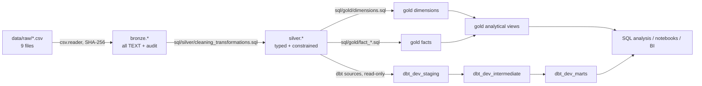

# Architecture

## 1. Purpose and scope

This document describes how the platform turns nine static Olist CSVs into a
governed PostgreSQL warehouse with auditable layers, orchestrated pipeline
runs, and a parallel dbt development branch. It covers the **implemented**
system, not an aspirational one.

Scope:

- Ingestion and audit (Bronze)
- Typing, constraints, and data-quality flags (Silver)
- Star schema and analytical views (Gold)
- dbt Core models in isolated `dbt_dev_*` schemas
- Airflow orchestration
- Local Docker/PostgreSQL topology

Out of scope: cloud deployment, streaming ingestion, dashboards with a live
BI tool, and ML serving.

## 2. System context

```text
┌──────────────────────────────────────────────────────────────────────────────┐
│                              Operator / Analyst                              │
│  Airflow UI (8080) · psql · notebooks · SQL analysis files · future BI       │
└───────────────────────────────┬──────────────────────────────────────────────┘
                                │
┌───────────────────────────────▼──────────────────────────────────────────────┐
│                         Apache Airflow 2.9.3                                 │
│  DAG: ecommerce_pipeline (LocalExecutor, manual schedule by default)         │
│  bronze_load → bronze_quality_gate → silver_rebuild →                       │
│  silver_quality_gate → gold_build                                            │
└───────────────────────────────┬──────────────────────────────────────────────┘
                                │ SQLAlchemy / psycopg2 (connection: ecommerce_postgres)
┌───────────────────────────────▼──────────────────────────────────────────────┐
│                       PostgreSQL 16 — ecommerce_dw                           │
│  bronze  → raw text + load audit                                             │
│  silver  → typed, constrained, flagged                                       │
│  gold    → dimensions, facts, analytical views                               │
│  dbt_dev_staging / dbt_dev_intermediate / dbt_dev_marts (dbt only)           │
└───────────────────────────────▲──────────────────────────────────────────────┘
                                │ read-only sources
┌───────────────────────────────┴──────────────────────────────────────────────┐
│                    dbt Core 1.9.4 + dbt-postgres 1.9.0                       │
│  33 models · 9 sources · 162 tests · restricted login dbt_dev_user           │
└──────────────────────────────────────────────────────────────────────────────┘

Sources: data/raw/*.csv  (9 files, 1,550,922 rows, static snapshot)
```

### 2.1 Current live topology (verified)

- Airflow webserver is reachable on `localhost:8080`; scheduler and webserver
  containers are healthy.
- Airflow metadata lives in its own `postgres:13` container and volume.
- The warehouse is a **host** PostgreSQL instance; the Airflow connection points
  at `host.docker.internal:5432`.
- The repository is bind-mounted into the Airflow container at
  `/opt/airflow/project`; the DAG file is symlinked into `/opt/airflow/dags`.
- The Airflow Compose project currently lives **outside this repository**. A
  fresh clone cannot reproduce the running scheduler until that Compose file is
  vendored (see §9 and `docs/runbook.md`).
- At audit time, the host PostgreSQL listened only on `127.0.0.1`, so the
  Airflow container could not connect. This is an environment defect, not a
  code defect; the runbook documents the fix.

## 3. Data flow



Two transformation paths are intentional:

1. **Production path:** SQL files in `sql/` build Bronze → Silver → Gold.
2. **Development path:** dbt reads Silver and builds an isolated candidate
   warehouse in `dbt_dev_*`. It never writes Bronze, Silver, or Gold.

## 4. Component responsibilities

| Component | Path | Responsibility | Does not do |
|---|---|---|---|
| CSV reader | `src/ecommerce_pipeline/ingestion/csv_reader.py` | Read as text, strip BOM, preserve leading zeros and empty strings | Clean or type data |
| Profiling | `src/ecommerce_pipeline/profiling/` | Inventory, duplicates, nulls, relationships | Mutate warehouse |
| Python transforms | `src/ecommerce_pipeline/transformation/` | Local preview cleaning; writes CSV | Feed the warehouse path |
| Validation helpers | `src/ecommerce_pipeline/validation/` | Reusable PK/FK/null/business checks | Enforce gates in Airflow |
| Bronze loader | `src/ecommerce_pipeline/loading/load_bronze.py` | Hash-based idempotent load, rejects, batch audit | Transform data |
| Silver/Gold loaders | `load_silver.py`, `load_gold.py` | Execute canonical SQL atomically | Contain business SQL |
| SQL | `sql/` | Source of truth for DDL, cleaning, star schema, views | Orchestrate |
| Airflow DAG | `orchestration/airflow/dags/ecommerce_pipeline_dag.py` | Sequence stages and gates; retries | Pass data between tasks |
| dbt project | `dbt_project/ecommerce_dbt/` | Staging/intermediate/marts in isolated schemas | Replace Gold |
| Docker | `infrastructure/docker/` | Local Postgres + app image | Start Airflow |
| Monitoring | `infrastructure/monitoring/` | Placeholders only | Collect metrics |

## 5. Stage-by-stage

### 5.1 Raw

- Nine UTF-8 CSVs with quoted fields and embedded newlines in reviews.
- One file carries a BOM (`product_category_name_translation.csv`).
- Zip prefixes must stay text; 23,995 customer, 1,027 seller, and 245,733
  geolocation values start with `0`.
- The dataset is a static snapshot; there is no source API or CDC feed.

### 5.2 Bronze

- One table per source file plus `load_batches` and `rejected_rows`.
- Every source column is `TEXT`.
- Audit columns: `_load_id`, `_source_file`, `_source_row_number`, `_loaded_at`.
- `UNIQUE(_load_id, _source_row_number)` prevents duplicate rows in a batch.
- Idempotency: SHA-256 of the file is the key; a `success` batch is skipped.
- A failed batch is retried after deleting its partial rows.
- Malformed rows (wrong field count, NUL bytes) go to `bronze.rejected_rows`.
- Loaded total: **1,550,922 rows** across 9 successful batches, 0 rejects on
  the audited snapshot.

### 5.3 Silver

- `TRUNCATE ... RESTART IDENTITY CASCADE` then rebuild from all Bronze rows.
- Types and constraints are enforced by PostgreSQL, not only by pandas.
- Suspicious records are **retained and flagged**, not dropped:
  `geolocation.is_outlier`, `products.category_missing`,
  `orders.delivery_anomaly` / `has_*`, payment zero flags, review text flags.
- Malformed records go to `silver.rejected_rows`.
- Row counts on the audited snapshot: customers 99,441; sellers 3,095;
  products 32,951; geolocation 738,300 (after dedup); orders 99,441;
  items 112,650; payments 103,886; reviews 99,224; categories 74.

### 5.4 Gold

- `DROP TABLE ... CASCADE`, then rebuild.
- 6 dimensions, 4 facts, 9 analytical views.
- `fact_orders` pre-aggregates items, payments, and reviews **before** joining
  to avoid fan-out.
- `dim_geolocation` collapses point rows to one row per zip using median
  coordinates that prefer non-outliers.
- Gold is the current production comparison layer; it is not dbt-managed.

### 5.5 dbt development branch

- Sources: the 9 Silver tables, declared read-only.
- `staging` (9 views) → `intermediate` (5 views) → `dimensions/facts/marts`
  (19 tables).
- Output schema macro allows only `dbt_dev_staging`,
  `dbt_dev_intermediate`, and `dbt_dev_marts`; it raises on any other target.
- Keys are deterministic MD5 hashes over natural identifiers, so they survive
  rebuilds (unlike Silver sequences and Gold `ROW_NUMBER()`).
- Verified: 33 models, 9 sources, 162 tests, 195-check full build.

### 5.6 Analytics

- 9 Gold views cover sales, delivery, RFM, category, seller, payment mix,
  reviews, payment reconciliation, and quality flags.
- `sql/analysis/*.sql` contains runnable business queries.
- Dashboards and notebooks are currently placeholders; the warehouse is the
  finished surface.

## 6. Orchestration design

### 6.1 DAG graph

```text
bronze_load ──▶ bronze_quality_gate ──▶ silver_rebuild ──▶
silver_quality_gate ──▶ gold_build
```

| Setting | Value |
|---|---|
| DAG id | `ecommerce_pipeline` |
| Executor | LocalExecutor |
| Schedule | `None` by default (manual); override with `ECOMMERCE_PIPELINE_SCHEDULE` |
| Catchup | `False` |
| Max active runs | 1 |
| Retries | 2, exponential backoff (5 min → max 30 min) |
| DAG run timeout | 6 hours |
| Connection id | `ecommerce_postgres` (override with `ECOMMERCE_AIRFLOW_CONN_ID`) |
| Owner | `data-engineering` |

The DAG deliberately coordinates **existing loaders and SQL**; it does not pass
DataFrames through XCom. Each task opens its own connection and disposes it.

### 6.2 Gates

- **Bronze gate:** each latest successful batch must match `EXPECTED_ROWS` and
  have zero rejected rows.
- **Silver gate:** 11 key-uniqueness checks, 9 required-value checks, 7
  relationship checks; rejects are counted and logged.
- **Gold:** no gate in the DAG today. dbt tests exist but are run separately.
  This is a known production gap (see `docs/decisions.md`, ADR-007).

## 7. Scheduling rationale

The checked-in dataset is a finite, immutable snapshot. A cron schedule would
re-run identical work and inflate run history without changing the warehouse,
so the default is `schedule=None` (manual trigger). For a live source, set
`ECOMMERCE_PIPELINE_SCHEDULE` to a cron expression or Airflow preset and add a
source-arrival sensor. The current design intentionally favors reproducible
manual runs over simulated freshness.

## 8. Full rebuild vs incremental

### Current behavior

| Layer | Strategy | Write pattern |
|---|---|---|
| Bronze | Incremental by file hash | Append new batch; skip successful hashes |
| Silver | Full rebuild | `TRUNCATE ... CASCADE` + insert all |
| Gold | Full rebuild | `DROP ... CASCADE` + `CREATE TABLE AS` |
| dbt | Full rebuild | Table materialization, no incremental models |

### Why this is acceptable now

- The dataset is static and small enough (1.55 M Bronze rows) to rebuild in
  minutes.
- Full rebuilds are simple to reason about and make every run reproducible.
- Deterministic dbt keys make rebuilds comparable across runs.

### Why it does not scale

- Silver ignores `_load_id`, so it cannot isolate a new batch or handle
  late-arriving corrections.
- `CASCADE` destroys downstream objects that are not part of the rebuild.
- Gold rebuild cost grows linearly with history and cannot serve concurrent
  readers without a swap strategy.
- No watermarks exist for incremental facts.

### Recommended evolution

1. Add a `_load_id`-aware Silver merge with a staging table and a swap.
2. Convert large facts to incremental dbt models keyed by natural keys.
3. Introduce a blue/green schema or view swap for Gold.
4. Add freshness and row-count assertions after Gold.

## 9. Reproducibility boundary

The repository currently reproduces the **warehouse build** but not the
**Airflow runtime**:

- `infrastructure/docker/docker-compose.yml` starts PostgreSQL and the app.
- Airflow is an external Compose project with its own metadata database and
  bind mounts.

To make the repo self-contained, vendor the Airflow Compose file and its
Dockerfile into `infrastructure/airflow/`, mount the repo, and document the
`ecommerce_postgres` connection in the same file. Until then, `docs/runbook.md`
describes both the current and target setups.

## 10. Security boundaries

- The Python pipeline uses `ecommerce_etl` with database `CREATE`; it owns the
  warehouse schemas.
- dbt uses a separate `dbt_dev_user`: login only, no superuser/createdb/
  createrole/inherit; `SELECT` on 9 Silver sources; `USAGE`/`CREATE` only on
  the three dev schemas; no access to Bronze or Gold.
- Credentials live in `.env` (mode 600, gitignored) and `DBT_POSTGRES_*`
  environment variables; no credentials are committed.
- The Airflow metadata database is separate from the warehouse database.

## 11. Known constraints and failure boundaries

- A failed Airflow task does not corrupt Bronze: each Bronze batch is committed
  transactionally and marked `success` only after all rows load.
- A failed Silver or Gold rebuild leaves the previous layer incomplete because
  the SQL runs in one transaction; PostgreSQL rolls back the transaction.
- If the warehouse is unreachable, the DAG fails at `bronze_load` before any
  gate runs; this is the current environment failure mode.
- The system has no alerting; failures are visible only in the Airflow UI and
  task logs.

## 12. Related documents

- `docs/runbook.md` — bring-up, trigger, troubleshoot, teardown
- `docs/data_dictionary.md` — every Bronze/Silver/Gold object
- `docs/decisions.md` — architectural decision records
- `docs/architecture/system_architecture.md` — legacy component view
- `docs/architecture/data_flow.md` — legacy data-flow notes
- `docs/dbt_architecture.md` — dbt dependency map and metric corrections
- `docs/data_quality/data_quality_report.md` — profiling evidence
